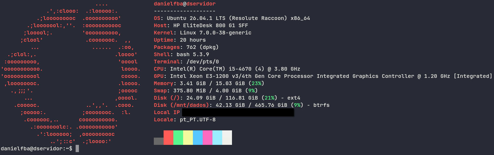
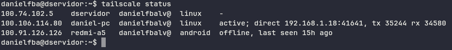
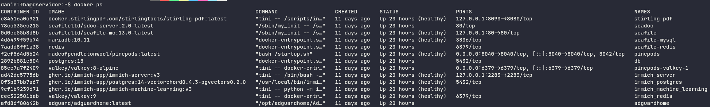

Um servidor pessoal, construido com hardware reutilizado: uma instancia de Ubuntu Server rodando containeres Docker, expostos somente via rede privadao Tailscale. Feito ambo para uso pessoal, e como projeto de aprendizagem.

## Hardware

HP EliteDesk SFF - Intel Core i5-4670

16GB DDR3

SSD 120GB (Sistema operacional, bancos de dados e volumes de alta performance)

HDD 500GB (Formatado em Btrfs para armazenamento primário de mídias e arquivos)

IP local reservado via DHCP estático no roteador

(Primeira tentativa usando um Lenovo 63 falhou, a placa-mãe estava com defeito, desligando após alguns minutos e só voltando a funcionar depois de horas parado. Deu para reaproveitar as memórias e hd)

## Arquitetura

Convenção: um diretório por serviço em /opt/<serviço> (Armazena as definições de infraestrutura como código com seu próprio docker-compose.yml + .env);

Dados e arquivos em /mnt/dados/<serviço>

/opt/

├── adguardhome/

├── homepage/

├── immich-app/

├── nextcloud/

├── pinepods/

├── seafile/ (banco de dados no SSD, arquivos no HDD)

├── syncthing/

/mnt/dados/

├── immich/photos/

├── nextcloud/data/

├── pinepods/{downloads,backups}/

├── seafile/{data,seadoc-data}/

├── syncthing/

## Segurança e Redes

Nenhuma porta do roteador é exposta diretamente para a internet pública, comunicação externa é feita exclusivamente através de uma rede Mesh VPN privada via Tailscale, apenas dispositivos autorizados acessam os painéis de controle e serviços. SSH feito somente via chave privada. 

## Stack

| Serviço | Proposito | Status |
| --- | --- | --- |
| Docker + Compose | Roda e orquestra os containers dos serviços | Feito |
| Tailscale | Rede VPN + certificado TLS | Feito |
| Cockpit | Painel de gerenciamento Web | Feito |
| AdGuard Home | Bloquador de anúncios/rastreadores a nivel de DNS | Feito |
| Seafile | Armazenamento e sincronização de arquivos (nuvem auto-hospedada) | Feito |
| Immich | Backup e gerenciamento de fotos e vídeos (Google Fotos auto-hospedado) | Feito |
| PinePods | Gerenciador de podcasts | Feito |
| StirlingPDF | Ferramenta de ediçao de pdf | Feito |
| Homepage | Painel de acesso para os apps no servidor | Planejado |
| Nextcloud | Alternativa para nuvem + pacote office completo | Descartado |

